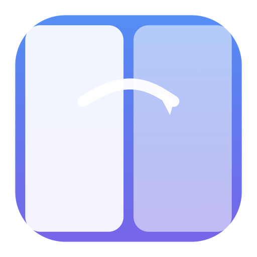
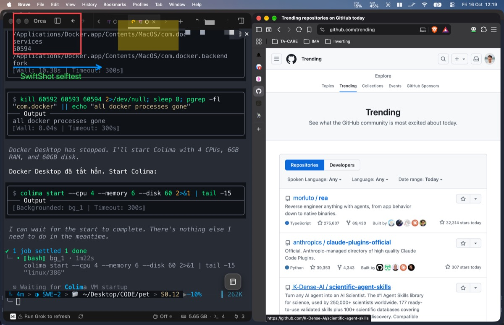
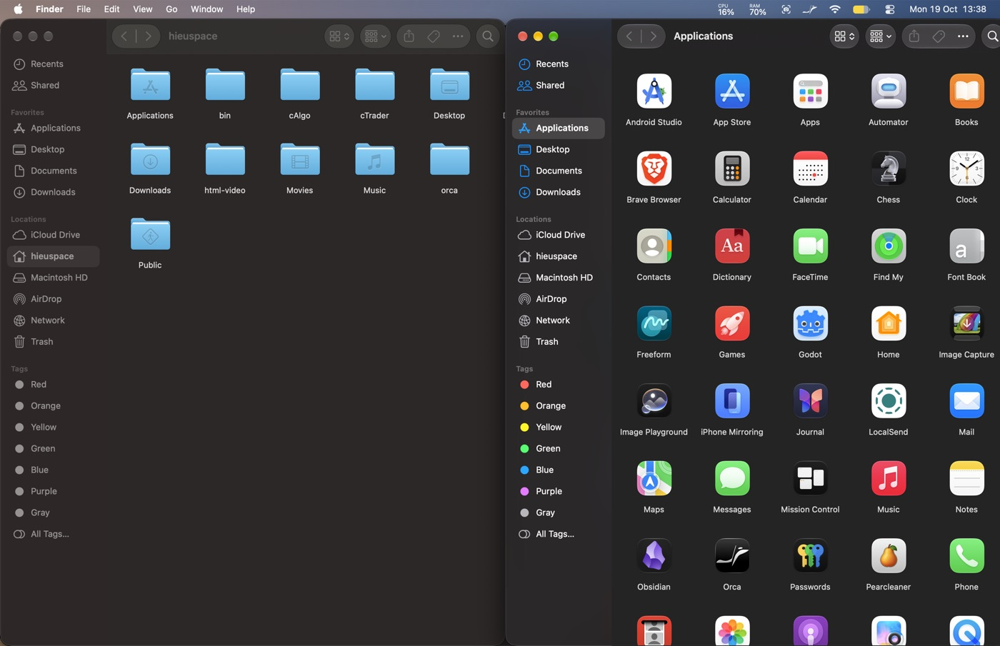

<div align="center">

# suite — hieuspace

**Free, native, open-source replacements for paid macOS utilities.**

[](https://suite.hieuspace.com)
[](https://suite.hieuspace.com)
[](#license)

</div>

---

## The suite

Each app replaces a paid tool — native Swift, no subscription, no telemetry.

| App | Replaces | What it does | Repo |
|---|---|---|---|
|  **SwiftShot** | CleanShot X | Menubar screenshot utility — ⌃⌘1 region, ⌃⌘2 fullscreen, full annotation editor (pen, arrow, highlight, mosaic, text), floating preview, clipboard or save. | [swiftshot](https://github.com/hieuspaceos/swiftshot) |
|  **SwishLite** | Swish | Trackpad window snapping — two-finger title-bar swipes → halves/thirds/quarters, pinch to maximize/quit, Dock gestures, haptics. | [swishlite](https://github.com/hieuspaceos/swishlite) |

Every app page carries a full rendered feature demo:

<p>
 
</p>

## Install an app

Zip → `/Applications` → open → grant permission. No Xcode needed.

1. Download the `.zip` from the app's GitHub **Releases**.
2. Drag the `.app` into `/Applications`.
3. Right-click → **Open** once if Gatekeeper asks.
4. Grant the permission the app requests (Screen Recording / Accessibility).

## This site

Astro + vanilla CSS, bilingual EN (`/`) and VI (`/vi/`). Apps are described
once in `src/data/apps.js` — pages, cards, i18n copy all derive from it.

```sh
npm install
npm run dev        # http://localhost:4321
npm run build      # dist/
```

### Deploy

Cloudflare Pages, project `suite`, Direct Upload:

```sh
npx wrangler pages deploy dist --project-name=suite --branch=main
```

> `--branch=main` is required — the default deploy lands on the
> `master` preview alias, not the custom domain.

Production: https://suite.hieuspace.com · Preview: https://suite-1lv.pages.dev

### Adding an app

1. Add an entry in `src/data/apps.js` — EN + VI copy, `icon`/`hero`/`demo`
   assets under `public/assets/`.
2. Create `src/pages/apps/<id>.astro` and `src/pages/vi/apps/<id>.astro`
   (copy an existing page, change the id).
3. `npm run build` → deploy.

### Demo videos

Rendered by [`demoreel`](https://github.com/hieuspaceos/demoreel) — a
vendorable headless renderer that draws the app's real AppKit views into
a scripted 1080p60 timeline (cursor, captions, zoom lens, chips). No
screen recording, fully deterministic.

## License

MIT — site and all apps in the suite.
